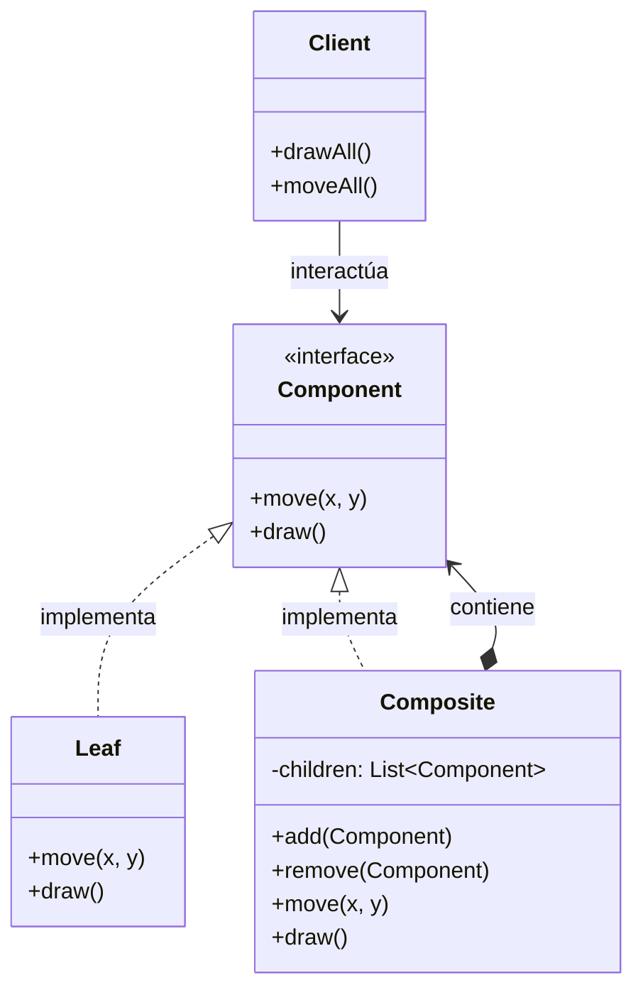
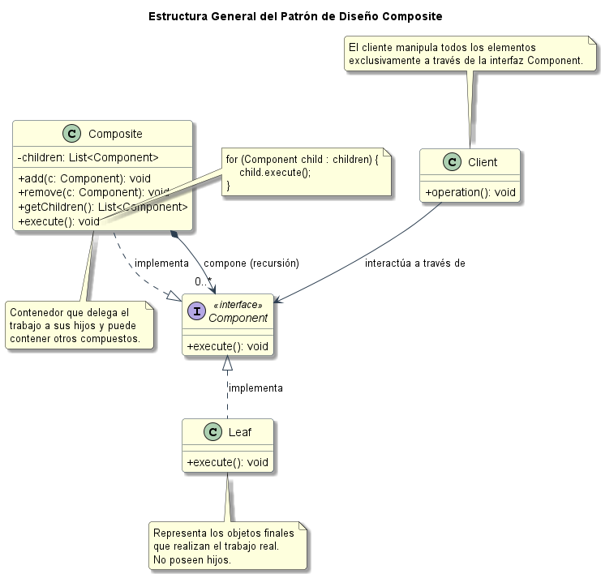
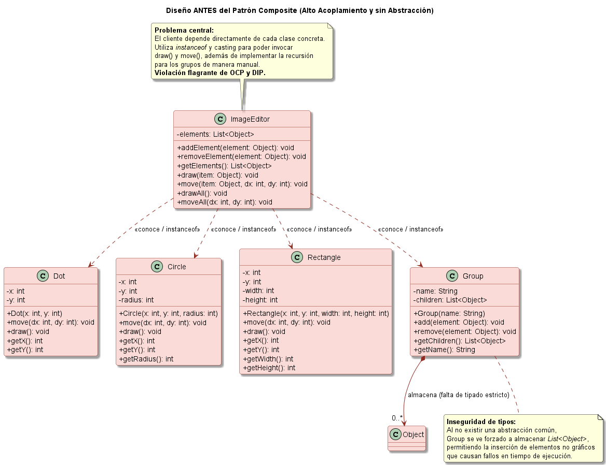
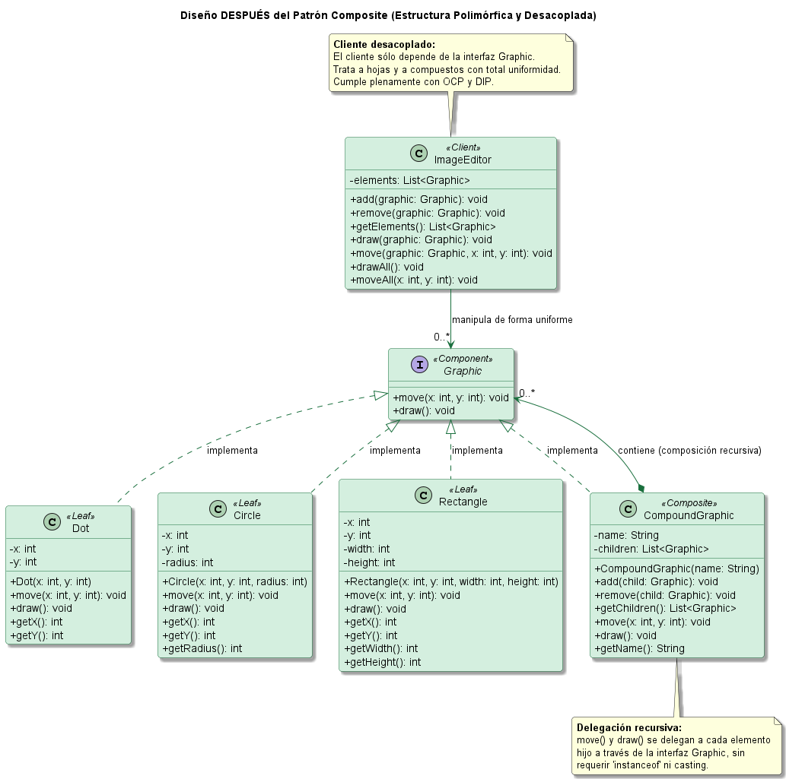

# Patrón de Diseño Estructural Composite en Java: Editor Gráfico de Formas Geométricas

[](https://www.oracle.com/java/)
[](https://maven.apache.org/)
[](https://junit.org/junit5/)
[](https://plantuml.com/)

---

## 1. Nombre del Proyecto

**Implementación del Patrón de Diseño Composite en Java - Caso Práctico: Editor Gráfico 2D (Antes vs. Después)**

---

## 2. Objetivo Académico

El objetivo primordial de este proyecto académico es demostrar de forma práctica, tangible y rigurosa la necesidad y los beneficios del patrón de diseño estructural **Composite**. A través de un caso de estudio centrado en un **Editor Gráfico 2D**, se contrastan dos arquitecturas de software:

1. **Diseño Inicial (`before-composite`)**: Sin aplicar el patrón. Las figuras y los grupos no comparten una abstracción común. El cliente se ve forzado a conocer todas las clases concretas, a inspeccionar tipos en tiempo de ejecución (`instanceof`) y a realizar recorridos recursivos manuales sobre estructuras heterogéneas (`List<Object>`).
2. **Diseño Refactorizado (`after-composite`)**: Aplicando fielmente el patrón Composite. Se define la interfaz común `Graphic`, permitiendo que tanto las hojas geométricas (`Dot`, `Circle`, `Rectangle`) como los contenedores (`CompoundGraphic`) sean tratados de manera completamente uniforme mediante polimorfismo y delegación recursiva.

---

## 3. ¿Qué es el Patrón Composite?

El **patrón Composite** es un patrón de diseño estructural que permite componer objetos en estructuras de árbol para representar jerarquías de parte-todo (*part-whole hierarchies*). 

Este patrón permite a los clientes tratar a los objetos individuales (hojas) y a las composiciones de objetos (compuestos) de manera **uniforme** e indiferenciada. En lugar de preocuparse por si un objeto es un elemento simple o un grupo complejo, el cliente invoca los mismos métodos polimórficos definidos en una interfaz común.

### Conceptos Clave
- **Composición de Árbol**: Un compuesto contiene una lista de componentes que a su vez pueden ser hojas o nuevos compuestos, permitiendo anidamientos de profundidad arbitraria.
- **Polimorfismo**: Las operaciones (`draw`, `move`) están declaradas en la raíz de la jerarquía (`Graphic`).
- **Delegación Recursiva**: Al invocar un método en un compuesto, este delega la llamada a todos sus hijos en cascada, eliminando bucles y lógica de inspección en el cliente.

---

## 4. Problema que se Pretende Resolver

En el desarrollo de aplicaciones que gestionan elementos gráficos, documentos jerárquicos o sistemas de archivos, es común necesitar agrupar objetos simples en entidades más complejas.

### Deficiencias del Diseño Previo (`before-composite`):
1. **Violación del Principio Open/Closed (OCP)**: Si se desea incorporar una nueva figura geométrica (por ejemplo, `Triangle`), es indispensable modificar el cliente `ImageEditor`, añadiendo nuevas ramas condicionales `if (item instanceof Triangle)` tanto en `draw()` como en `move()`.
2. **Alto Acoplamiento**: El cliente conoce y depende de cada implementación concreta (`Dot`, `Circle`, `Rectangle`, `Group`).
3. **Pérdida de Seguridad de Tipos (*Type Safety*)**: Como los grupos no tienen una abstracción compartida con las formas, se ven obligados a almacenar `List<Object>`. Cualquier objeto arbitrario (por ejemplo, un `String`) puede ser introducido accidentalmente, provocando excepciones `ClassCastException` o `IllegalArgumentException` en tiempo de ejecución.
4. **Carga Algorítmica en el Cliente**: El cliente asume la responsabilidad indebida de navegar la jerarquía y gestionar la recursión.

### Solución con el Patrón Composite (`after-composite`):
- Se unifica el contrato bajo la interfaz `Graphic`.
- El cliente `ImageEditor` trabaja únicamente contra `Graphic`.
- El compuesto `CompoundGraphic` encapsula la recursión y administra una colección estrictamente tipada: `List<Graphic>`.
- Nuevas formas pueden crearse sin alterar el cliente ni los compuestos existentes.

---

## 5. Arquitectura y Participantes del Patrón

El patrón Composite define cuatro participantes esenciales:



1. **Component (`Graphic`)**:
   - Interfaz común que declara las operaciones estándar tanto para elementos primitivos como compuestos (`move(int x, int y)`, `draw()`).
2. **Leaf (`Dot`, `Circle`, `Rectangle`)**:
   - Representan los elementos terminales de la jerarquía geométrica (no tienen hijos).
   - Implementan directamente el comportamiento real de dibujo y alteración de coordenadas relativas.
3. **Composite (`CompoundGraphic`)**:
   - Representa el elemento contenedor que posee elementos hijos (`List<Graphic>`).
   - Implementa `Graphic` propagando y delegando recursivamente las llamadas `draw()` y `move()` a sus hijos.
   - Proporciona métodos para gestionar hijos: `add(Graphic child)` y `remove(Graphic child)`.
4. **Client (`ImageEditor`)**:
   - Interactúa con todos los elementos exclusivamente a través del tipo `Graphic`.
   - Desconoce si un objeto es un punto simple o una compleja jerarquía con cientos de formas anidadas.

---

## 6. Estructura de Carpetas

El proyecto está organizado como un repositorio Maven multimódulo estándar y desacoplado:

```text
patron-composite-java/
├── .gitignore
├── pom.xml                                   # POM raíz (configuración de módulos y versiones)
├── README.md                                 # Documentación técnica y académica completa
├── before-composite/                         # MÓDULO 1: Versión sin aplicar el patrón
│   ├── pom.xml
│   └── src/
│       ├── main/java/com/patron/composite/before/
│       │   ├── Dot.java                      # Punto (coordenadas x, y)
│       │   ├── Circle.java                   # Círculo (x, y, radio)
│       │   ├── Rectangle.java                # Rectángulo (x, y, ancho, alto)
│       │   ├── Group.java                    # Agrupación usando List<Object>
│       │   ├── ImageEditor.java              # Cliente acoplado con 'instanceof' y recursión manual
│       │   └── Main.java                     # Demostración en consola de la versión antes
│       └── test/java/com/patron/composite/before/
│           └── BeforeCompositeTest.java      # 6 pruebas unitarias con JUnit 5
├── after-composite/                          # MÓDULO 2: Versión con patrón Composite
│   ├── pom.xml
│   └── src/
│       ├── main/java/com/patron/composite/after/
│       │   ├── Graphic.java                  # Interfaz Component común
│       │   ├── Dot.java                      # Hoja: Punto implementando Graphic
│       │   ├── Circle.java                   # Hoja: Círculo implementando Graphic
│       │   ├── Rectangle.java                # Hoja: Rectángulo implementando Graphic
│       │   ├── CompoundGraphic.java          # Compuesto: Contenedor List<Graphic> con delegación
│       │   ├── ImageEditor.java              # Cliente desacoplado y 100% polimórfico
│       │   └── Main.java                     # Demostración en consola con anidamiento
│       └── test/java/com/patron/composite/after/
│           └── AfterCompositeTest.java       # 7 pruebas unitarias con JUnit 5
└── docs/
    ├── uml/                                  # Diagramas PlantUML e imágenes renderizadas
    │   ├── composite-general.puml            # Fuente PlantUML conceptual
    │   ├── composite-general.png             # Imagen renderizada
    │   ├── before-composite.puml             # Fuente PlantUML versión previa
    │   ├── before-composite.png              # Imagen renderizada
    │   ├── after-composite.puml              # Fuente PlantUML versión refactorizada
    │   └── after-composite.png               # Imagen renderizada
    └── examples/
        └── execution-output.md               # Evidencia de ejecución real de las demostraciones
```

---

## 7. Requisitos de Instalación

- **Java Development Kit (JDK)**: Versión 17 LTS o superior (desarrollado y verificado en OpenJDK 21 LTS).
- **Apache Maven**: Versión 3.8.0 o superior (verificado con Maven 3.9.6).
- **Git**: Para el control de versiones.
- *(Opcional)* **PlantUML / Graphviz**: Para visualizar o regenerar los diagramas UML.

Verifique su entorno ejecutando:
```bash
java -version
mvn -version
```

---

## 8. Cómo Compilar y Ejecutar

### Compilar todo el proyecto y ejecutar las pruebas:
Desde la raíz del repositorio (`patron-composite-java/`):
```bash
mvn clean test
```

### Ejecutar la versión ANTES de Composite (`before-composite`):
```bash
mvn exec:java -pl before-composite
```
O directamente con Java:
```bash
java -cp before-composite/target/classes com.patron.composite.before.Main
```

### Ejecutar la versión DESPUÉS de Composite (`after-composite`):
```bash
mvn exec:java -pl after-composite
```
O directamente con Java:
```bash
java -cp after-composite/target/classes com.patron.composite.after.Main
```

---

## 9. Ejemplo de Salida Real

A continuación se presentan las transcripciones literales de las ejecuciones en consola obtenidas en el entorno:

### Salida de `before-composite`:
```text
======================================================================
  DEMOSTRACIÓN: ANTES DEL PATRÓN COMPOSITE (Diseño con Acoplamiento)
======================================================================
En este diseño:
1. Dot, Circle, Rectangle y Group no comparten interfaz común.
2. Group almacena 'Object', perdiendo seguridad de tipos.
3. ImageEditor debe verificar con 'instanceof' y recorrer manualmente la jerarquía.

>>> 1. ESTADO INICIAL: Dibujando jerarquía de elementos...
=== Lienzo del Editor Gráfico (Sin Composite) ===
┌── [Grupo: Grupo Principal (4 elementos)]
  • Punto en las coordenadas (5, 10)
  • Círculo con centro en (15, 20) y radio 5
  • Rectángulo en esquina superior izquierda (30, 40) con ancho 10 y alto 20
┌── [Grupo: Subgrupo Detalles (2 elementos)]
  • Punto en las coordenadas (13, 19)
  • Punto en las coordenadas (17, 19)
└── [Fin de Grupo: Subgrupo Detalles]
└── [Fin de Grupo: Grupo Principal]
=================================================

>>> 2. OPERACIÓN DE MOVIMIENTO: Desplazando (10, 15)...
El cliente ImageEditor recorre recursivamente el grupo usando 'instanceof'.

>>> 3. ESTADO FINAL: Dibujando elementos tras el desplazamiento...
=== Lienzo del Editor Gráfico (Sin Composite) ===
┌── [Grupo: Grupo Principal (4 elementos)]
  • Punto en las coordenadas (15, 25)
  • Círculo con centro en (25, 35) y radio 5
  • Rectángulo en esquina superior izquierda (40, 55) con ancho 10 y alto 20
┌── [Grupo: Subgrupo Detalles (2 elementos)]
  • Punto en las coordenadas (23, 34)
  • Punto en las coordenadas (27, 34)
└── [Fin de Grupo: Subgrupo Detalles]
└── [Fin de Grupo: Grupo Principal]
=================================================

Demostración finalizada exitosamente.
```

### Salida de `after-composite`:
```text
======================================================================
  DEMOSTRACIÓN: DESPUÉS DEL PATRÓN COMPOSITE (Diseño Uniforme)
======================================================================
En este diseño:
1. Todos los elementos implementan la interfaz común 'Graphic'.
2. CompoundGraphic gestiona una colección tipada List<Graphic>.
3. ImageEditor trata tanto a hojas como a compuestos de forma 100% polimórfica.
4. No se utiliza ningún 'instanceof' ni casting en el cliente ni en los compuestos.

>>> 1. ESTADO INICIAL: Invocando draw() a través del editor...
=== Lienzo del Editor Gráfico (Con Patrón Composite) ===
┌── [Compuesto: Grupo Principal (4 hijos)]
  • Punto en las coordenadas (5, 10)
  • Círculo con centro en (15, 20) y radio 5
  • Rectángulo en esquina superior izquierda (30, 40) con ancho 10 y alto 20
┌── [Compuesto: Subgrupo Detalles (2 hijos)]
  • Punto en las coordenadas (13, 19)
  • Punto en las coordenadas (17, 19)
└── [Fin Compuesto: Subgrupo Detalles]
└── [Fin Compuesto: Grupo Principal]
========================================================

>>> 2. OPERACIÓN DE MOVIMIENTO: Desplazando (10, 15)...
La operación move() se propaga automáticamente por toda la jerarquía gracias a la delegación.

>>> 3. ESTADO FINAL: Invocando draw() tras el movimiento...
=== Lienzo del Editor Gráfico (Con Patrón Composite) ===
┌── [Compuesto: Grupo Principal (4 hijos)]
  • Punto en las coordenadas (15, 25)
  • Círculo con centro en (25, 35) y radio 5
  • Rectángulo en esquina superior izquierda (40, 55) con ancho 10 y alto 20
┌── [Compuesto: Subgrupo Detalles (2 hijos)]
  • Punto en las coordenadas (23, 34)
  • Punto en las coordenadas (27, 34)
└── [Fin Compuesto: Subgrupo Detalles]
└── [Fin Compuesto: Grupo Principal]
========================================================

>>> 4. DEMOSTRACIÓN DE UNIFORMIDAD (Hoja y Compuesto tratados idénticamente):
Dibujando una hoja individual:
  • Punto en las coordenadas (99, 99)
Dibujando un subgrupo compuesto:
┌── [Compuesto: Subgrupo Detalles (2 hijos)]
  • Punto en las coordenadas (23, 34)
  • Punto en las coordenadas (27, 34)
└── [Fin Compuesto: Subgrupo Detalles]

Demostración finalizada exitosamente.
```

---

## 10. Comparación Técnica: Antes vs. Después

| Criterio de Comparación | Antes de Composite (`before-composite`) | Después de Composite (`after-composite`) |
| :--- | :--- | :--- |
| **Abstracción Común** | No existe. Cada forma es una clase aislada. | Interfaz común `Graphic` con métodos `draw()` y `move(x, y)`. |
| **Acoplamiento del Cliente** | Muy alto. Conoce `Dot`, `Circle`, `Rectangle`, `Group`. | Muy bajo. El cliente sólo depende de la abstracción `Graphic`. |
| **Principio Abierto/Cerrado (OCP)** | Se viola. Cada nueva forma exige modificar métodos del cliente. | Se cumple plenamente. Se agregan formas sin tocar código existente. |
| **Inspección de Tipos** | Requiere múltiples `instanceof` y conversiones de tipo explícitas. | Cero condicionales de tipo. Delegación puramente polimórfica. |
| **Seguridad de Tipos (*Type Safety*)** | Débil. `Group` almacena `List<Object>` con riesgo en tiempo de ejecución. | Fuerte en compilación. `CompoundGraphic` usa `List<Graphic>`. |
| **Responsabilidad de la Recursión** | El cliente (`ImageEditor`) debe gestionar los ciclos y la navegación recursiva. | El compuesto (`CompoundGraphic`) encapsula la delegación recursiva interna. |
| **Tratamiento de Elementos** | Heterogéneo y diferenciado. | Completamente uniforme y transparente. |

---

## 11. Diagramas UML

Los diagramas fueron elaborados en formato PlantUML (`.puml`) y exportados a imágenes PNG de alta resolución ubicadas en [`docs/uml/`](docs/uml/).

### A. Estructura General del Patrón Composite (`docs/uml/composite-general.puml`)
Muestra la relación canónica entre `Client`, `Component`, `Leaf` y `Composite`, con la composición recursiva `Composite *--> Component`.



### B. Diseño Previo a Composite (`docs/uml/before-composite.puml`)
Muestra el acoplamiento directo de `ImageEditor` hacia cada clase concreta y el uso de `List<Object>` en `Group`.



### C. Diseño Posterior con Patrón Composite (`docs/uml/after-composite.puml`)
Muestra la realización de `Graphic` por parte de las hojas y de `CompoundGraphic`, así como la interacción desacoplada del cliente.



### Instrucciones para Visualizar y Renderizar los Diagramas PlantUML

1. **En Visual Studio Code / Antigravity IDE**:
   - Instale la extensión **PlantUML** de *Jebbs* (`jebbs.plantuml`).
   - Abra cualquier archivo `.puml` dentro de `docs/uml/`.
   - Presione `Alt + D` para previsualizar el diagrama interactivo.
2. **Generación por Consola (CLI)**:
   - Teniendo Java instalado, puede ejecutar:
     ```bash
     java -jar plantuml.jar docs/uml/*.puml
     ```

---

## 12. Pruebas Automatizadas

El proyecto cuenta con una suite completa de pruebas unitarias implementadas en **JUnit 5**, distribuidas en ambos módulos:

```bash
mvn clean test
```

### Resultados de Ejecución Real:
- **`before-composite` (6 pruebas, 0 fallos)**:
  - `testCreateShapes`: Creación e invocación de dibujo de figuras geométricas.
  - `testGroupAddAndRemove`: Gestión de hijos en `Group`.
  - `testClientTraverseGroupWithIndividualElements`: Recorrido y dibujo de elementos desde el cliente.
  - `testClientNestedGroupsRecursiveProcessing`: Procesamiento recursivo manual de subgrupos anidados.
  - `testMovementPropagationAcrossNestedHierarchy`: Verificación de propagación de coordenadas en grupos y subgrupos.
  - `testUnsupportedTypeFailure`: Demostración del riesgo de `List<Object>` al recibir tipos no soportados.
- **`after-composite` (7 pruebas, 0 fallos)**:
  - `testLeafOperations`: Verificación polimórfica de `Dot`, `Circle` y `Rectangle` bajo `Graphic`.
  - `testCompoundGraphicAddRemoveAndValidation`: Validación de inserción, eliminación y prevención de ciclos/nulos.
  - `testCompoundGraphicDraw`: Ejecución de dibujo en compuestos.
  - `testMovementPropagationAcrossNestedDescendants`: Propagación recursiva de coordenadas relativas en árbol.
  - `testUniformTreatmentViaGraphicInterface`: Tratamiento uniforme de hojas y compuestos vía `Graphic`.
  - `testImageEditorCollectionManagement`: Ciclo de vida y gestión del lienzo en `ImageEditor`.
  - `testConsoleOutputContainsHierarchyInfo`: Verificación de la jerarquía textual en consola.

**Total: 13 pruebas ejecutadas, 100% exitosas.**

---

## 13. Conclusiones

1. **Simplicidad para el Cliente**: El patrón Composite simplifica drásticamente el código del cliente al eliminar ramas condicionales `if-else` e inspecciones `instanceof`. El cliente se enfoca en la intención del negocio (`draw()`, `move()`) en lugar de en la estructura interna de los objetos.
2. **Facilidad de Extensión**: La arquitectura se vuelve modular y extensible. Agregar nuevas figuras primitivas o nuevos tipos de agrupaciones complejas no requiere modificar ninguna clase existente, cumpliendo estrictamente con el principio Open/Closed.
3. **Encapsulamiento de la Complejidad**: La lógica de recorrido jerárquico se traslada del cliente al compuesto, logrando una alta cohesión y una clara separación de responsabilidades.
4. **Balance de Diseño (Transparencia vs. Seguridad)**: El patrón prioriza la **transparencia** (tratar hojas y compuestos de igual modo). Para preservar la seguridad, los métodos de gestión de hijos (`add`, `remove`) se han definido en `CompoundGraphic` sin sobrecargar la interfaz `Graphic` con métodos vacíos o que lancen excepciones en las hojas.

---

## 14. Referencia Bibliográfica

- **Refactoring.Guru**. (s. f.). *Composite*. Recuperado de [https://refactoring.guru/es/design-patterns/composite](https://refactoring.guru/es/design-patterns/composite)
- **Gamma, E., Helm, R., Johnson, R., & Vlissides, J.** (1994). *Design Patterns: Elements of Reusable Object-Oriented Software*. Addison-Wesley.
- **Bloch, J.** (2018). *Effective Java* (3.ª ed.). Addison-Wesley Professional.
